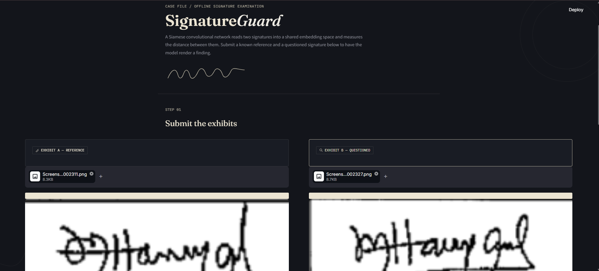
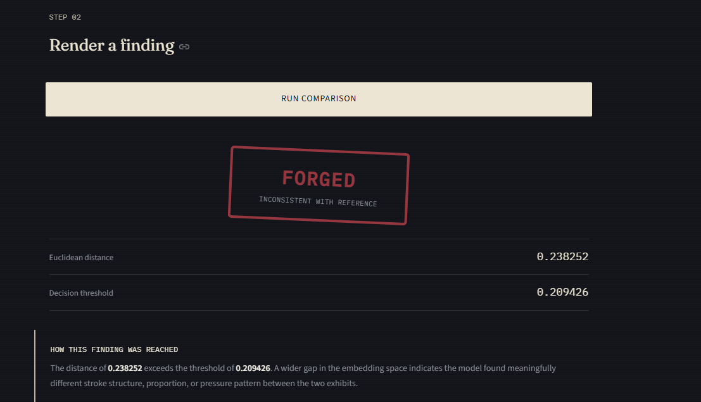

# Signature Forgery Detection Using Deep Learning

A deep learning-based signature verification system that uses a **Siamese Neural Network** to compare two handwritten signatures and determine whether they are genuine or potentially forged.

The project uses contrastive loss to learn signature similarity, Euclidean distance to compare signature embeddings, and a validation-based threshold for verification.

---

## Application Preview

### Signature Verification Interface



### Verification Results



---

## Overview

Handwritten signature verification is an important biometric authentication technique used to verify identity in documents and financial transactions.

This project implements a signature verification system using a Siamese Convolutional Neural Network (CNN). Instead of classifying a single signature independently, the model learns to compare two signature images and measure how similar they are.

The system takes two signature images as input:

- **Reference Signature:** A known genuine signature.
- **Questioned Signature:** A signature that needs to be verified.

The model generates embeddings for both images and calculates their Euclidean distance. A threshold selected using validation data is then used to classify the pair as genuine or forged.

## Key Features

- Siamese CNN architecture for signature verification.
- Contrastive loss for learning signature similarity.
- Image preprocessing using OpenCV.
- Writer-level training, validation, and testing splits.
- Genuine-genuine and genuine-forged signature pair generation.
- Euclidean distance-based verification.
- Validation-based threshold selection.
- Performance evaluation using classification metrics.
- Confusion matrix and ROC curve generation.
- Interactive Streamlit application for signature comparison.

## Tech Stack

| Category | Technologies |
|---|---|
| Programming Language | Python |
| Deep Learning | TensorFlow, Keras |
| Image Processing | OpenCV, Pillow |
| Data Handling | NumPy |
| Machine Learning Evaluation | Scikit-learn |
| Visualization | Matplotlib, Seaborn |
| Web Application | Streamlit |

## Dataset

This project uses the **CEDAR Signature Dataset**, which contains genuine and forged handwritten signature samples from multiple writers.

Dataset source:

[CEDAR Signature Dataset – Kaggle](https://www.kaggle.com/datasets/shreelakshmigp/cedardataset)

### Dataset Preparation

Download the dataset and arrange the folders according to the following structure:

```text
dataset/
└── CEDAR/
    ├── full_org/
    └── full_forg/
```

- `full_org/` contains genuine signature images.
- `full_forg/` contains forged signature images.

**Note:** The dataset is not included in this repository. Download it separately and place it in the specified directory before training or evaluation.

## Model Architecture

The project uses a **Siamese Convolutional Neural Network** consisting of two identical branches that share the same weights.

Each branch processes one signature image and generates a 128-dimensional feature embedding.

### Architecture

1. **Input Layer:** Accepts grayscale signature images of size 155 × 220 × 1.
2. **Convolutional Layers:** Four convolutional layers with 32, 64, 128, and 256 filters extract visual features.
3. **Batch Normalization:** Helps stabilize training.
4. **Max Pooling:** Reduces spatial dimensions while retaining important features.
5. **Global Average Pooling:** Converts feature maps into a compact feature representation.
6. **Fully Connected Layers:** A 256-unit dense layer with ReLU activation and dropout learns higher-level representations.
7. **Embedding Layer:** Generates a normalized 128-dimensional embedding.

The two embeddings are compared using Euclidean distance.

### Contrastive Loss

The model is trained using **Contrastive Loss**, which encourages similar signature pairs to have smaller distances and dissimilar pairs to have larger distances.

The loss function implemented in the project is:

\[
L = yD^2 + (1-y)\max(m-D,0)^2
\]

Where:

- \(y\) represents the pair label.
- \(D\) represents the Euclidean distance between embeddings.
- \(m\) represents the margin.

In this project:

- Label `1` represents a genuine pair.
- Label `0` represents a forged pair.
- The margin is set to `1.0`.

## Image Preprocessing

Before being passed to the model, signature images undergo the following preprocessing steps:

1. Convert the image into grayscale.
2. Apply Otsu's thresholding for foreground extraction.
3. Crop the signature to remove unnecessary background regions.
4. Resize the signature while maintaining its aspect ratio.
5. Place the resized signature on a white canvas.
6. Normalize pixel values between 0 and 1.
7. Reshape the image into the required input dimensions.

Final image dimensions:

```text
155 × 220 × 1
```

## Training Configuration

The following configuration parameters are used for model training:

| Parameter | Value |
|---|---|
| Image Height | 155 |
| Image Width | 220 |
| Channels | 1 |
| Batch Size | 32 |
| Epochs | 10 |
| Learning Rate | 0.0001 |
| Embedding Dimension | 128 |
| Contrastive Loss Margin | 1.0 |
| Random State | 42 |

### Dataset Splitting

The dataset is divided at the writer level to prevent signatures belonging to the same writer from appearing across different data splits.

| Split | Proportion |
|---|---:|
| Training | 80% |
| Validation | 10% |
| Testing | 10% |

Genuine-genuine pairs and genuine-forged pairs are generated separately for each split, with up to 30 pairs per class for each writer.

The training process uses:

- **Early Stopping:** Monitors validation loss and restores the best weights.
- **ReduceLROnPlateau:** Reduces the learning rate when validation loss stops improving.
- **Model Checkpointing:** Saves the best-performing model during training.

## Model Evaluation

The model is evaluated using a separate test set after selecting the verification threshold using validation data.

The following evaluation metrics are calculated:

- Accuracy
- Precision
- Recall
- F1-Score
- ROC-AUC

The project also generates:

- Confusion Matrix
- ROC Curve
- Evaluation Metrics in JSON format

The evaluation script saves the generated results inside the `outputs/` directory.

The verification threshold is selected by optimizing the F1-score on the validation set, with accuracy used as a tie-breaker. The selected threshold is then applied to the test set.

### Evaluation Considerations

- The model is trained and evaluated using a limited number of signature pairs generated from the CEDAR dataset.
- The number of pairs is controlled by the pair-generation configuration, which allows up to 30 genuine and 30 forged pairs per writer.
- The reported evaluation metrics reflect performance on the specific dataset and writer-level splits used in this project.
- A high test accuracy, including 100% if achieved, should not be interpreted as a guarantee of equivalent performance on completely unseen datasets or real-world signatures.
- Further testing on independent datasets and more diverse signature samples would be required to establish broader generalization.

## Installation and Setup

### 1. Clone the Repository

```bash
git clone https://github.com/simratkaur210555/Signature-Forgery-Detection-Using-Deep-learning.git
```

### 2. Navigate to the Project Directory

```bash
cd Signature-Forgery-Detection-Using-Deep-learning
```

### 3. Create a Virtual Environment

```bash
python -m venv venv
```

Activate it:

**Windows:**

```bash
venv\Scripts\activate
```

**macOS/Linux:**

```bash
source venv/bin/activate
```

### 4. Install Dependencies

```bash
pip install -r requirements.txt
```

### 5. Prepare the Dataset

Download the CEDAR Signature Dataset and place its `full_org` and `full_forg` folders inside:

```text
dataset/CEDAR/
```

## Running the Project

### Step 1: Train the Model

Run the following command from the project root directory:

```bash
python -m src.train
```

This generates signature pairs, preprocesses the images, trains the Siamese CNN, and saves the model.

### Step 2: Evaluate the Model

```bash
python -m src.evaluation
```

This evaluates the trained model, determines the optimal verification threshold using validation data, and generates the evaluation metrics and visualizations.

### Step 3: Launch the Streamlit Application

```bash
streamlit run app.py
```

The application opens in your browser.

## How to Use the Application

1. Launch the Streamlit application.
2. Upload a genuine reference signature.
3. Upload the questioned signature.
4. Click the verification button.
5. The application preprocesses both images and compares their learned embeddings.
6. The result is displayed as either **GENUINE** or **FORGED**, along with the calculated distance and verification threshold.

A smaller Euclidean distance indicates greater similarity between the two signature representations.

## Source Code Description

| File | Description |
|---|---|
| `app.py` | Streamlit interface for signature verification. |
| `src/config.py` | Stores project paths and model configuration parameters. |
| `src/dataset.py` | Loads signature images, generates pairs, and creates dataset splits. |
| `src/preprocessing.py` | Performs image preprocessing and normalization. |
| `src/model.py` | Defines the Siamese CNN and contrastive loss function. |
| `src/train.py` | Handles model training and checkpointing. |
| `src/evaluation.py` | Calculates evaluation metrics and generates visualizations. |
| `src/predict.py` | Handles signature comparison and verification predictions. |

## Limitations

- The model depends on the quality and consistency of uploaded signature images.
- Performance may vary with differences in image resolution, scanning conditions, and signature appearance.
- The system evaluates static signature images and does not analyze dynamic handwriting information such as pen pressure, writing speed, or pen movement.
- A genuine prediction indicates similarity according to the trained model and does not establish the legal authenticity of a signature.

**This project is intended for educational and experimental purposes. It should not be treated as a certified forensic verification system or a substitute for professional examination.**

## Future Improvements

- Experiment with more advanced Siamese and metric-learning architectures.
- Improve generalization across different signature datasets.
- Explore additional image augmentation techniques.
- Evaluate performance under different image quality conditions.
- Develop a more comprehensive signature verification interface.

## Author

**Simrat Kaur**

B.Tech Computer Science and Engineering (AI & ML)

---

If you find this project useful, consider giving the repository a ⭐.
